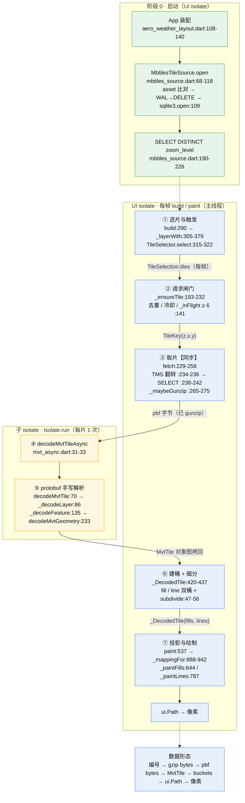

# mbtiles 矢量瓦片加载链路导览

> **写给谁**：想看懂 geo_map 里「一张 mbtiles 矢量瓦片是怎么从磁盘走到屏幕」的人，以及准备自己评估加载效率、但还没把整条链路读通的人。假定你没写过 MVT 解码，也没用过 Dart 的 **isolate**。
>
> **代码基准**：`C:\WorkSpace\Flutter\geo_map`，版本 `0.2.1`，提交 `a179d6d`。文中所有路径都相对这个根目录书写，例如 `packages/geo_map/lib/src/style/mvt_vector_layer.dart:193`。**链路文件的行号基于 `a179d6d`；如果你手上的代码已经改过，请以函数名为准，不要拿行号硬找。**
>
> **本文不做什么**：不给出任何优化方案，也不评判当前实现的好坏。它只回答三件事——现在的代码在做什么、数据在哪一步变成什么形状、你要自己下判断时该看哪里。

---

## 0. 先说清楚这份文档怎么用

### 0.1 本文是 / 不是什么

**是**：一张按当前代码逐阶段编号的链路地图，加一份动手前的自查手册。范围只有一条线：`MbtilesTileSource` 取出 `.mbtiles` 里的瓦片字节，到 `MvtVectorLayer` 把它画成填充和线。

**不是**：不是掉帧诊断报告，不是性能优化结论清单，也不是地图引擎的功能总览。下面这些一律不展开：气泡弹窗、要素拾取、天气图层、符号碰撞、极区补片、卫星影像源、瓦片淡入动画。**栅格瓦片链路**只在「两套栈并存」这一处作为边界提一句——因为不点破它，你几乎一定会把栅格的配置误安到矢量头上。

### 0.2 和 `docs/` 里已有几篇的分工

| 文档 | 讲什么 | 和本文的关系 |
|---|---|---|
| `docs/perf-drag-framedrop-research.md` | 拖动掉帧的根因调研，含一组可落地的方案清单 | 主题是**渲染侧**、且已含结论；本文不重复它的内容 |
| `docs/MAPLIBRE_TILE_PIPELINE.md` | 瓦片管线的六段原理与业界对标 | 讲「一般分为几段」，本文讲「这段代码具体在哪几行」 |
| `docs/TILE_FADE.md` | 瓦片淡入与交叉淡入 | 属于绘制表现，不在本文链路内 |
| `docs/ARCHITECTURE.md` | 引擎整体架构与模块划分 | 全局视角；本文只切其中一条纵切面 |

一句话：那几篇回答「为什么、别人怎么做」，本文回答「此刻磁盘上这段代码到底做了什么、我该去哪里核对」。

### 0.3 怎么读

全文三段式：

1. **§1 总览** —— 先建立全局：目标、结构、模块、数据结构、数据流向、敏感环节在哪。读完应能对着白纸画出主流程。
2. **§2 分阶段细讲** —— 按代码执行顺序拆成 8 个阶段，每阶段给文件、函数、输入输出、依赖边界、效率疑点。这是全文主体，也是你后面核对代码时真正会翻的部分。
3. **§3 修改前准备** —— 要补哪些概念、先打开哪几个文件、怎么量、改一处会连累谁、有哪些原理性的坑、退回到哪。

> 如果你的目标很明确，就是「自己定位瓶颈」，可以直接跳到 **§1.6 敏感点索引表 → §2 各阶段表格的末行 → §3.3 自查问题清单**。

**关于类比**：全文用一条主线类比（把瓦片的一生想成一次「书库 → 订单 → 拣货 → 拆包 → 外包抄写 → 切格加工 → 橱窗」的过程），另外三处各用一个小类比解释局部。每个小类比出现时会先框住「只用于解释 X，到本节结束」，不会和主线抢名词。

---

## 术语速查表

正文里每个术语第一次出现时会**加粗**并再给一句白话。这张表供你随时回查。

### ① 瓦片与编号

| 术语 | 一句话释义 | 首次出现 |
|---|---|---|
| **瓦片（Tile）** | 把世界地图切成的一张张小方块，每张单独存储、单独加载 | §1.1 |
| **瓦片金字塔 / zoom（z）** | 第 `z` 级把世界切成 `2^z × 2^z` 张；`z` 越大，每张覆盖的地面越小、细节越多 | §1.1 |
| **`TileKey(z,x,y)`** | 一张瓦片的「订单号」：层级、列号、行号，链路里所有 Map/Set 的键 | §1.1 |
| **XYZ / TMS** | 两种行号数法：XYZ 从**北**往南数（`y=0` 在北），TMS 从**南**往北数；MBTiles 用后者 | §2.3 |
| **TMS 翻转** | `y_tms = 2^z - 1 - y_xyz`，取片时把订单号换算成货架号 | §2.3 |
| **webMercator** | 常见的 2D 平面投影（EPSG:3857），瓦片到屏幕是线性变换 | §1.2 |
| **MBTiles** | 一种把瓦片塞进 SQLite 表的文件格式，表 `tiles(z, tile_column, tile_row, tile_data)` | §2.0 |
| **MVT / pbf** | Mapbox Vector Tile，矢量瓦片格式；用 protobuf（简称 pbf）二进制编码 | §1.1 |
| **source-layer** | MVT 内部按名字分的图层（如 `countries`、`land`），样式按名字去取 | §2.6 |
| **`desiredZ / dataZoom / renderZoom`** | 相机想要的层级 / 数据源实际有数据的层级 / 实际拿来画的层级，三者可能不同 | §2.1 |
| **`TileSelection`** | 一次选片的结果，含上面三个 zoom 与可见瓦片集合 `tiles` | §2.1 |
| **overzoom / underzoom** | 放大超过数据最深层级时用最深瓦片拉伸 / 缺口用更粗的祖先瓦片占位 | §2.1 |

### ② 字节与格式

| 术语 | 一句话释义 | 首次出现 |
|---|---|---|
| **gzip / 魔数 `1F 8B`** | 一种压缩；gzip 文件头两字节固定是十六进制 `1F 8B`，代码靠它判断要不要解压 | §2.3 |
| **protobuf / wire type** | 二进制序列化格式；每个字段用 `tag = 字段号<<3 \| 编码类型` 标识，编码类型有 0(varint)/2(长度前缀) 等 | §2.5 |
| **varint** | 变长整数：每字节只存 7 位数据，最高位表示「后面还有」，小数字占得少 | §2.5 |
| **zigzag** | 把有符号整数折成无符号再编 varint，公式 `(v>>>1) ^ -(v&1)` | §2.5 |
| **geometry command** | MVT 把几何压成一串指令：`(次数<<3)\|编号`，1=MoveTo / 2=LineTo / 7=ClosePath，参数是相对坐标增量 | §2.5 |
| **extent（默认 4096）** | 一张瓦片内部的坐标刻度上限，几何坐标是这个方格纸上的整数 | §2.5 |
| **PbfReader / `sublistView`** | 本引擎手写的 protobuf 读取器；`Uint8List.sublistView` 是「视图」，切子消息不拷内存 | §2.5 |
| **`TileFetchResult` / `TileFailureKind`** | 一次取片的结果封装；失败分 `notFound / network / decode / empty` 四类 | §2.3 |

### ③ 并发与线程

| 术语 | 一句话释义 | 首次出现 |
|---|---|---|
| **isolate** | Dart 的并发单元：各自独立内存与事件循环，之间只能靠「消息传递（拷贝）」通信，不共享内存 | §1.3 |
| **UI isolate / 主线程** | Flutter 主 isolate，负责 build、paint、平台通道；一帧的预算就在这里 | §1.3 |
| **`Isolate.run`** | 开一个一次性子 isolate 跑一个函数再把结果拷回来，跑完就销毁 | §2.4 |
| **sendable** | 能安全跨 isolate 传递的值：基本类型、可传递的 List/Map、`Uint8List` 等 | §2.4 |
| **`dart:ui` / `ui.Path`** | Flutter 的原生绘制对象（底层 Skia 资源），既不可跨 isolate 传递，也只能在创建它的线程上绘制 | §2.4 |
| **有 `async` 无 `await` 仍同步** | 函数签名写了 `async`，但函数体里没有 `await` 时，整段仍在调用方线程一口气跑完 | §2.3 |
| **fire-and-forget** | 发起一个异步调用但不等待它，让它自己跑完再回调 | §2.1 |
| **条件导出 / web stub** | 按编译平台换实现文件；web 上 MBTiles 源换成一个直接抛 `UnsupportedError` 的占位类 | §1.2 |
| **WAL→DELETE / 只读句柄** | SQLite 的日志模式转换；`Database` 是原生句柄，绑定创建它的 isolate，不能跨线程传 | §2.0 |

### ④ 调度与缓存

| 术语 | 一句话释义 | 首次出现 |
|---|---|---|
| **限流 `_inFlight` / `_maxConcurrent`** | 同时在途的请求数与它的上限，这里硬编码为 6 | §2.2 |
| **去重 `_pending` / `_decoded`** | 同一订单在途或已完成，就不再重复下单 | §2.2 |
| **冷却 `_retryAfter` / 指数退避 / TTL** | 失败后隔一段时间才允许重试，间隔按次数翻倍并封顶 | §2.2 |
| **FIFO 淘汰** | 缓存满了先删最早进来的那张（不是删最久没用的） | §2.2 |
| **`_knownEmpty`** | 数据源明确回答「这片不存在」的订单号，当作「已解析的空瓦片」处理 | §2.2 |
| **去抖 debounce** | 相机移动时暂停发起新请求、等它停稳再发；**本引擎里只属于栅格链路** | §1.6 |
| **优先级队列 / generation 失效** | 按离屏中心远近排队 / 相机变了就丢弃旧请求结果；**矢量层当前两者都没有** | §1.6 |
| **`_revision`** | 一个自增整数，每次 `setState` 靠它通知 painter 重绘 | §2.2 |

### ⑤ 几何与绘制

| 术语 | 一句话释义 | 首次出现 |
|---|---|---|
| **桶（bucket）** | 把解码后的要素预先整理成「渲染就绪」的填充多边形 / 折线列表 | §2.6 |
| **细分 subdivide / granularity** | 球面要逐点投影，稀疏线段会切进球面，所以按 `1/granularity` 网格插点；粒度随 zoom 变化 | §2.6 |
| **`normalizeMvtRing`** | 坐标 ÷ extent，把 4096 方格纸换算到 `[0,1]` 的瓦片单位，好让同一份桶 2D/3D 都能用 | §2.6 |
| **Liang–Barsky 裁剪** | 把折线裁到瓦片边界内的算法 | §2.6 |
| **仿射 / `TileAffine`** | 2D 下瓦片到屏幕是「原点 + 两个基向量」的线性变换，算一次角点即可 | §2.7 |
| **正射投影 / 背面剔除 / 地平线裁剪** | 3D 球体视图：逐点转球面向量再点积，背面的点丢弃，边缘按地平线裁 | §2.7 |
| **world copies** | 2D 平移越过 ±180° 时，同一张瓦片要在多个世界副本位置各画一遍 | §2.7 |
| **`CustomPaint` / `shouldRepaint` / `RepaintBoundary`** | Flutter 自绘三件套；`shouldRepaint` 决定这一帧要不要重画 | §2.7 |
| **帧预算 / FPS** | 一帧约 16.7ms（60fps）；FPS 是每秒帧数 | §1.6 |

### ⑥ 观测与工程

| 术语 | 一句话释义 | 首次出现 |
|---|---|---|
| **`MvtDiagnostics` / `GeoDiagnostics`** | 矢量层的结构化诊断回调 / 引擎侧日志总开关（后者仅 debug 构建生效） | §3.3 |
| **HUD / profile / DevTools Performance** | 屏上调试浮层 / 性能构建模式 / Flutter 的帧耗时录制工具 | §3.3 |
| **`dart test` / `flutter test`** | 纯 Dart VM 单测 / Flutter Widget 测试，两者的运行环境不同 | §3.3 |
| **SAC** | 项目机器上的安全策略，会拦截 `flutter_tester.exe` | §3.3 |
| **`path:` 依赖 / 副本 / 零漂移** | App 用本地路径引用 SDK；它持有一份源码副本；两边逐文件一致叫零漂移 | §1.2 |

---

# 第一部分 · 总览

## 1.1 这条链路在干一件什么事

一句话：把 `.mbtiles` 里某个 `(z,x,y)` 对应的**一段压缩 protobuf 字节**，变成屏幕上的填充色块和线条。

听上去简单，但中间要换五六次「形态」：

```
订单号 (z,x,y)
  → 数据库里的一行压缩字节
  → 解压后的 protobuf 字节
  → Dart 对象图（瓦片 / 图层 / 要素 / 顶点）
  → 按填充和线分好的几何桶
  → ui.Path
  → 像素
```

### 主类比 A：一次瓦片的一生（贯穿全文）

把整个引擎想成一家**只卖地图卡片的出版社**：

- `.mbtiles` 文件是**中央书库**，一张瓦片是其中一本薄册子，**`TileKey(z,x,y)` 是订单号**；
- 相机每帧算出「这屏要哪几本」，等于**开出一批订单**（§2.1）；
- 仓库按订单号拣货，但书架编号是从下往上数的，得先把订单号翻成货架号（§2.3 的 TMS 翻转）；
- 册子出厂是**真空压缩包装**的，拆包才能读（§2.3 的 gzip 解压）；
- 内容是密文，交给**外包的抄写员**誊成卡片再送回来（§2.4 的子 isolate）；
- 卡片回来后要**按颜色分类、再切成小格**，方便上架（§2.6 的桶与细分）；
- 最后每帧把**橱窗重新摆一遍**（§2.7 的投影与绘制）。

这个类比会一路用到 §2.8 收束。它只负责串起「物」的流动，不解释字节内部长什么样（那是 §2.5 的事），也不解释谁挡住了重复订单（那是 §2.2 的事）。

## 1.2 整体结构：三个包，两套栈

| 层 | 位置 | 性质 | 在这条链路里负责 |
|---|---|---|---|
| `geo_map_core` | `packages/geo_map_core/` | **纯 Dart**，依赖只有 `latlong2`；没有 flutter、没有 `dart:ui`、没有 `dart:io`、没有 sqlite3 | 坐标换算、选片、protobuf 解码、几何桶、细分、投影数学 |
| `geo_map` | `packages/geo_map/` | Flutter 层，依赖 `sqlite3 ^2.9.4`、`path_provider`、`geo_map_core` | 打开 MBTiles、`fetch` 取片、图层状态机、`CustomPainter` 绘制 |
| App | `app_client/lib/` | 业务工程，用 `pubspec.yaml` 里的 `path: ./packages/geo_map` 引用一份**源码副本** | 创建数据源、传入样式、决定 2D/3D、挂诊断回调 |

**权威源是真仓** `C:\WorkSpace\Flutter\geo_map`；App 消费的是 `app_client/packages/{geo_map,geo_map_core}` 里的副本。这两份源码都被各自的 git 跟踪，改了真仓必须同步副本（§3.6 会给完整的三步与校验命令）。另有 `app_ohos`、`globe_lab` 等工程也引用了各自的副本。

> **最容易看错的一点**：`TileEngine`（栅格瓦片）和 `MvtVectorLayer`（本文的矢量瓦片）是**两套彼此独立的请求 / 缓存 / 解码栈**。它们不共用队列、不共用缓存、也不共用并发上限。文档里凡提到「栅格」，都是在帮你划清边界，不是在讲本文链路。
>
> 另有一处平台边界：`packages/geo_map/lib/geo_map.dart:85-86` 用条件导出，在 web 上把 `mbtiles_source.dart` 换成 `mbtiles_source_stub.dart`；后者的 `open()` / `fetch()` 直接抛 `UnsupportedError`。也就是说 MBTiles 这条路只在原生端存在。

## 1.3 数据流向、调用关系与线程边界

下面这张图是全篇的地图。**三个框 = 三条线程归属**：阶段 0、1、2、3、6、7 全在 UI isolate，只有阶段 4、5 在一次性子 isolate 里。阶段 ③ 特意标了「同步」——它的函数签名写着 `async`，但函数体里没有 `await`。



> 图注：虚线表示「提供依赖 / 配置」，实线表示逐片的数据流。栅格 `TileEngine` 是另一条独立链路，不在这张图里（见 §1.2）。

**关键边界一览**：

| 边界 | 位置 | 说明 |
|---|---|---|
| 唯一的 `await` 分界 | `mvt_vector_layer.dart:212` | 之前是取片，之后是 `decodeMvtTileAsync` 回到 UI 线程继续构造 `_DecodedTile` |
| 进 / 出子 isolate | `mvt_async.dart:31-33` | 字节拷进去、`MvtTile` 对象图拷回来；全链路只有这一处 `Isolate.run` |
| `setState` 触发点 | `mvt_vector_layer.dart:222 / 259 / 285` | 瓦片加载成功、失败记录、重试计时器轮询，各触发一次重建 |
| 缓存写入点 | `mvt_vector_layer.dart:214` | `_decoded[key] = _DecodedTile(...)` |
| 缓存清空点 | `mvt_vector_layer.dart:172-183` | `didUpdateWidget` 发现 `source` 身份变了，清空全部状态 |

> **小类比 C（只用于解释跨线程搬运，到 §2.4 结束）**：把字节交给子 isolate，像把原件**复印一份寄给外包抄写员**，他誊好的卡片再**复印一份**寄回来——来回都是拷贝。而 `ui.Path` 像一块玻璃原件，既不能寄（不可 sendable），也只有本店的橱窗能摆（绑定创建它的线程），所以它只能在 UI 线程里现做。

## 1.4 模块职责

| 模块 | 文件（相对真仓根） | 职责 | 线程 | 上下游 |
|---|---|---|---|---|
| `GeoMap` / `GeoMapOptions` | `packages/geo_map/lib/src/widget/geo_map.dart:20-47` | 装配相机、模式、子图层 | UI | 把 `MvtVectorLayer` 挂进部件树 |
| `MvtVectorLayer` 状态机 | `packages/geo_map/lib/src/style/mvt_vector_layer.dart:138-287` | 去重、限流、失败退避、缓存淘汰、重建通知 | UI | 选片结果 → 请求；解码结果 → 缓存 |
| `_layerWith` | `mvt_vector_layer.dart:305-379` | 每帧选片、触发请求、规划占位、组装 painter | UI | `TileSelector` / `resolveVectorDrawTiles` / `planAncestorRequests` |
| `TileSelector` | `packages/geo_map_core/lib/src/tiles/tile_selector.dart` | 算出这一屏需要哪些瓦片、用哪个数据层级 | 纯 Dart（UI 调用） | 相机 + 数据源 zoom 范围 → `TileSelection` |
| `resolveVectorDrawTiles` | `packages/geo_map_core/lib/src/mvt/mvt_resolution.dart:50` | 把可见瓦片分成「已就绪 / 占位 / 缺口」 | 纯 Dart | 供 painter 与祖先请求使用 |
| `planAncestorRequests` | `packages/geo_map_core/lib/src/tiles/tile_recovery.dart:45` | 缺口逐级上溯，找更粗的祖先瓦片占位 | 纯 Dart | 触发额外的 `_ensureTile` |
| `MbtilesTileSource` | `packages/geo_map/lib/src/source/mbtiles_source.dart:32` | 打开库、按 `(z,x,y)` 查行、解压、封装结果 | UI（同步） | `(z,x,y)` → `TileFetchResult` |
| `TileGrid.rowForFetch` | `packages/geo_map_core/lib/src/tiles/tile_scheme.dart:110-113` | XYZ → TMS 行号翻转 | 纯 Dart | `fetch` 内部 |
| `decodeMvtTileAsync` | `packages/geo_map_core/lib/src/mvt/mvt_async.dart:31-33` | 把 protobuf 解码放到子 isolate | 子 isolate | pbf 字节 → `MvtTile` |
| `PbfReader` + `decodeMvtTile` | `packages/geo_map_core/lib/src/mvt/{pbf_reader,mvt}.dart` | 手写 protobuf 解析，产出对象图 | 子 isolate | 字节 → 瓦片 / 图层 / 要素 |
| `buildMvtFillBucket` / `buildMvtLineBucket` | `packages/geo_map_core/lib/src/mvt/mvt_bucket.dart:70-90 / 96-122` | 分类、裁剪、归一化、细分，产出几何桶 | UI（虽是纯 Dart） | `MvtLayer` → 多边形 / 折线列表 |
| `mvtSubdivisionGranularity` | `packages/geo_map_core/lib/src/mvt/mvt_subdivide.dart:47-56` | 按 zoom 算细分网格密度 | 纯 Dart | 供两个 bucket 函数使用 |
| `_MvtPainter` | `packages/geo_map/lib/src/style/mvt_vector_layer.dart:507` | 逐点投影、合并 `ui.Path`、绘制 | UI | 几何桶 → 像素 |

> 表里「纯 Dart（UI 调用）」这一栏值得留意：**代码是纯 Dart，不等于它跑在子线程**。`geo_map_core` 里大部分函数都被 UI 线程直接调用，真正离 UI 的只有 `mvt_async.dart:31-33` 那一处。

## 1.5 关键数据结构

| 结构 | 定义位置 | 字段 / 含义 | 活多久 |
|---|---|---|---|
| `TileKey` | `tile_scheme.dart:141-157` | `z / x / y`，重写了 `==` 与 `hashCode` | 不可变，用作所有 Map / Set 的键 |
| `TileSelection` | `tile_selector.dart:31-64` | `desiredZ / dataZoom / renderZoom / tiles`，另有过缩放状态 | 每帧 `_layerWith` 生成一次 |
| `VectorDrawTiles` | `mvt_resolution.dart:21-43` | `placeholders / ready / missing` + `drawOrder` | 每帧生成一次 |
| `TileFetchResult` | `tile_source.dart:22-41` | `bytes?` / `failure?` / `isOk` / `isNotFound` | 一次 `fetch` 一个，用完即弃 |
| `TileFailureKind` | `tile_cache_policy.dart:15-27` | 枚举：`notFound / network / decode / empty` | 常量 |
| `MvtTile` | `mvt.dart:56-67` | `List<MvtLayer> layers`，另有线性查找的 `layer(name)` | 子 isolate 内构造 → 拷回 → 被 `_DecodedTile` 持有 |
| `MvtLayer` | `mvt.dart:40-54` | `name / extent(默认4096) / version / features` | 同上 |
| `MvtFeature` | `mvt.dart:22-38` | `id / type / properties / geometry`（ring 列表） | 同上 |
| `Vec2` | `math/geo_geometry.dart:6-20` | 两个 `double`；**每个顶点一个对象** | 随 bucket 留在缓存里 |
| `MvtFillPolygon` / `MvtPolyline` | `mvt_bucket.dart:36-53` | `rings` / `points` + `properties` | `_DecodedTile` 构造时创建 |
| `_DecodedTile` | `mvt_vector_layer.dart:420-468` | `tile / fills / lines / _symbols(lazy) / z,x,y` | `_decoded[key]`，FIFO 淘汰或换 source 时清空 |
| `_TileMapping` | `mvt_vector_layer.dart:475-505` | `project / copies / worldSize / dashSeed? / clipRing?` | **每帧 × 每 style layer × 每 tile 新建**，帧末即弃 |
| `MvtDiagnostics` | `mvt_vector_layer.dart:56-91` | `dataZoom / tileCount / readyCount / failedCount / lastStatusCode / firstFailed` | 每帧统计、去重后回调 |

State 里还有十个字段共同构成「谁在加载、谁失败了、谁不存在的」全部记忆：

| 字段 | 行号 | 作用 |
|---|---|---|
| `_decoded` | `:143` | 已解码瓦片缓存 `Map<TileKey,_DecodedTile>` |
| `_pending` | `:144` | 在途订单号 |
| `_retryAfter` | `:147` | 何时可以重试 |
| `_failures` | `:150` | 每个订单失败过几次（退避曲线） |
| `_failureStatus` | `:153` | 上次失败的传输状态码（给诊断用） |
| `_fallback` | `:158` | 作为占位而额外请求的祖先瓦片 |
| `_knownEmpty` | `:164` | 数据源明确回答「不存在」的瓦片 |
| `_inFlight` | `:166` | 当前在途数量 |
| `_revision` | `:167` | 重建计数器 |
| `_lastDiag` | `:169` | 上一帧诊断，用于去重 |

## 1.6 性能敏感环节一览（先知道去哪儿看）

下面只列**位置和事实**，不排序、不下结论。每一行在 §2 都有对应细讲。

| # | 位置 | 当前代码里发生的事实 | 细讲 |
|---|---|---|---|
| 0 | `mbtiles_source.dart:127-149 / 190-226` | 每次 `open` 全量读 asset 逐块比对，并扫一次 `DISTINCT zoom_level` | §2.0 |
| 1 | `mvt_vector_layer.dart:305-379` | 每帧 `build` 都重跑选片、规划占位、触发请求 | §2.1 |
| 2 | `mvt_vector_layer.dart:141 / 202 / 219-221` | 并发上限硬编码 6；缓存是 FIFO、按张数 160 淘汰 | §2.2 |
| 3 | `mbtiles_source.dart:238-242 / 265-275` | sqlite 查询与 gzip 解压在 UI 线程同步执行；无字节缓存 | §2.3 |
| 4 | `mvt_async.dart:31-33` | 每片瓦片派生一次 isolate，字节与对象图双向拷贝 | §2.4 |
| 5 | `mvt.dart:243` | 每个顶点新建一个 `Vec2` 对象 | §2.5 |
| 6 | `mvt_vector_layer.dart:420-437` | 每个 source-layer 都同时建 fill 与 line 两种桶；细分按 zoom 一律执行 | §2.6 |
| 7 | `mvt_vector_layer.dart:888-942` | 每帧 × 每 style layer × 每 tile 重新构造投影映射 | §2.7 |

> **⚠️ 最容易误读的一处，请特别记住**
>
> `geo_engine_tuning.dart:50` 有个 `tileRequestDebounceMillis = 120`，`tile_scheduler.dart:28` 的 `TileScheduler.canRequest` 读它。看到「120ms 去抖」很容易以为矢量瓦片在拖动时会停发请求——**不是这样**。
>
> `TileScheduler` 只被栅格 `TileEngine` 使用。矢量层走的是自己的 `_ensureTile`（`mvt_vector_layer.dart:193-232`）：**没有去抖、没有优先级队列、没有 generation 失效**，只有一个 `_inFlight >= 6` 的硬闸门。
>
> 同理，`_maxConcurrent = 6`（`:141`）和 `maxCachedTiles = 160`（`:104`）**不在 `GeoEngineTuning` 里**；数据源自己声明的 `maxConcurrentRequests => sqliteParallelRequests = 4`（`mbtiles_source.dart:54`）也**没有被矢量层读取**。核对时一律以调用点为准，不要以常量名推断行为。

---

# 第二部分 · 按当前代码分阶段细讲

这一部分是全文主体。八个小节都套同一个模板：**一句话定位 → 四行表 → 涉及文件与函数 → 编号流程与依赖边界 → 效率疑点**。

「效率疑点」一栏只写**代码里正在发生的事**，末尾把判断依据交回给你：要观察什么、量什么、和什么对比。本文不替你回答「这段值不值得改」。

文中路径省略公共前缀时，规则是：
- 写 `mvt_vector_layer.dart:193` → `packages/geo_map/lib/src/style/mvt_vector_layer.dart:193`
- 写 `mbtiles_source.dart:229` → `packages/geo_map/lib/src/source/mbtiles_source.dart:229`
- 写 `mvt.dart:70` / `mvt_async.dart:31` / `mvt_bucket.dart:70` / `mvt_subdivide.dart:47` / `tile_scheme.dart:110` / `tile_scheduler.dart:28` / `geo_engine_tuning.dart:50` → `packages/geo_map_core/lib/src/` 下对应的 `mvt/` / `tiles/` / `tuning/` 子目录

---

## 2.0 阶段 0 · 打开数据源：书库建档

> 主类比 A 的第一站：把出版社的书库搬到门店旁边，确认书架编号，然后登记「本店共有哪几层书」。

**一句话定位**：App 启动时把 `assets` 里的 `.mbtiles` 变成一个可查的只读 SQLite 连接，并确定这份数据真实的 zoom 范围。

|          | 内容                                                                              |
| -------- | ------------------------------------------------------------------------------- |
| **输入**   | `id`（数据源名）、`assetPath`（Flutter asset 路径，如 `assets/tiles/world_borders.mbtiles`） |
| **输出**   | 一个 `MbtilesTileSource` 实例，持有唯一的 `Database _db` 与 `minZoom / maxZoom`            |
| **处理**   | 拷资产 → 校验副本 → 转换日志模式 → 只读打开 → 扫描真实层级                                             |
| **效率疑点** | 每次 `open` 全量读 asset 并逐字节比对；开库时扫一次 `DISTINCT zoom_level`                         |

**涉及文件与函数**

- `mbtiles_source.dart:68-118` — `MbtilesTileSource.open({required String id, required String assetPath})`
- `mbtiles_source.dart:127-149` — `_matchesAsset(...)`，副本内容比对
- `mbtiles_source.dart:151-162` — `_toRollbackJournal(...)`，WAL → DELETE
- `mbtiles_source.dart:173-188` — `_hasTilesTable(...)`，损坏副本自愈
- `mbtiles_source.dart:190-226` — `_readZoomRange(...)`，真实层级扫描

**处理逻辑（按顺序）**

1. `:72` 调 `getApplicationDocumentsDirectory()` 拿到可写目录（这是平台通道，只能在主 isolate 里做）。目标文件落在 `<documents>/geo_map/<basename>`，目录不存在就递归创建。
2. `:78-80` 用 `rootBundle.load(assetPath)` 把整个 asset 读进内存。
3. `:82` 调 `_matchesAsset`：先比长度，再以 1 MiB 为块逐字节比对磁盘副本；比对时**跳过 SQLite 文件头偏移 18、19 两个字节**（那两字节记录日志模式，转过 WAL 后会变，不跳过会永远判成「不一致」）。
4. 不一致时 `:84-91` 删掉主文件与 `-wal` / `-shm` 两个旁文件，重新写入，并执行 `_toRollbackJournal`：`PRAGMA wal_checkpoint(TRUNCATE)` + `PRAGMA journal_mode = DELETE`。注释说明的原因很实在——只读的 WAL 副本缺 `-wal` 旁文件就打不开。
5. `:97-107` `_hasTilesTable` 查 `sqlite_master` 确认 `tiles` 存在（允许它是 VIEW）；若副本损坏，再复制一次自愈。
6. `:109` **`sqlite3.open(target.path, mode: OpenMode.readOnly)`** —— 全链路唯一的数据库连接。
7. `:110` `_readZoomRange` 以**数据真值优先**：`SELECT DISTINCT zoom_level FROM tiles ORDER BY zoom_level ASC`（`:196-197`）；`metadata` 表里的 minzoom/maxzoom 只作为扫描失败时的回退（`:213-214`）。这样避免了元数据谎报层级。
8. `:116-117` 走私有构造 `MbtilesTileSource._(id, db, minZ, maxZ)`。

**依赖边界**：这一步跨了 `dart:io`、`package:path_provider`、`package:flutter/services.dart`（`rootBundle`）、`package:sqlite3`。**`Database` 是原生句柄，绑定创建它的 isolate，不能跨 isolate 传递**；`rootBundle` 与 `getApplicationDocumentsDirectory` 也只能待在主 isolate。这个边界直接决定了后面「取片」为什么还在 UI 线程。

**效率疑点（事实 + 观察维度）**

- `mbtiles_source.dart:127-149`：每次 `open` 都要全量读一次 asset 并逐块比对，代码注释也自认「一次 open 一次全量 asset 读」。文件越大，这段越长（App 里 `world_borders.mbtiles` 约 14.75 MiB）。
- `mbtiles_source.dart:196-197`：`DISTINCT zoom_level` 在开库时扫一次表的层级分布。
- `:141` 逐字节循环里有跳过 18/19 偏移的分支判断。
- 这一阶段只建立连接，**没有瓦片字节缓存**；后面每次 `fetch` 都重新查库、重新解压。

> 要判断这一段是否值得关注，可以量一次冷启动里 `open()` 的返回耗时，并把它与「副本已存在且内容一致」和「副本不存在需重拷」两种情形分别对比；同时留意 `[geo_map:mbtiles]` 打出的 `cache matches asset` 与 `re-copying`（`mbtiles_source.dart:83 / :93`）。

---

## 2.1 阶段 1 · 选片与触发：开订单

> 主类比 A：相机每看一屏，就等于开出一批订单号。这里先决定「要哪几本」，再决定「缺货的用哪本旧的顶上」。

**一句话定位**：每一帧 `build` 都根据相机重新算出可见瓦片集合，对每张缺的瓦片发起一次（不等待的）加载请求，同时规划祖先占位，最后组装出 painter。

| | 内容 |
|---|---|
| **输入** | `MapCamera`（中心、zoom、视口尺寸、投影模式）、`StyleSpec`、`widget.source.minZoom/maxZoom` |
| **输出** | 一组 fire-and-forget 的 `_ensureTile(key)` 调用；一个 `RepaintBoundary(CustomPaint(_MvtPainter))` 部件 |
| **处理** | 构造 `CameraState` → 算 `desiredZ` → 选片 → 触发请求 → 分 ready/placeholder/missing → 上溯祖先 → 报诊断 |
| **效率疑点** | 每帧 `build` 都重跑选片、占位规划与请求触发；`_mappingFor` 的调用次数在这时就埋下了（见 §2.7） |

**涉及文件与函数**

- `mvt_vector_layer.dart:290-303` — `_MvtVectorLayerState.build(BuildContext)`
- `mvt_vector_layer.dart:305-379` — `_layerWith(MapCamera, StyleSpec)`
- `tile_selector.dart:82-89 / 97-124` — `TileSelector.coveringZoomLevel` / `select`
- `mvt_resolution.dart:50-93` — `resolveVectorDrawTiles(...)`（**定义位置**，`:332` 是调用点）
- `tile_recovery.dart:45-67` — `planAncestorRequests(...)`（**定义位置**，`:340-357` 是调用点）
- `mvt_vector_layer.dart:381-409` — `_reportDiagnostics(...)`

**处理逻辑（按顺序）**

1. `:291` `MapCamera.of(context)` 取相机；`:292-293` 视口尺寸非正时直接返回空 `SizedBox`。
2. `:295-302` 若传了运行时样式 `controller`，用 `AnimatedBuilder` 包一层；静态 `style` 则直接进 `_layerWith`。
3. `:306-308` 判定投影：`camera.projectionDelegate is FlatProjectionDelegate` 决定 `flat`，据此选 `MercatorProjector` 或 `OrthographicProjector`。
4. `:309-313` 把相机信息整理成纯 Dart 的 `CameraState`（中心、zoom、视口）。
5. `:315-322` `coveringZoomLevel(state)` 得到 `desiredZ`，再由 `TileSelector.select(...)` 产出 `TileSelection`。其中 `dataZoom = desiredZ.clamp(sourceMinZoom, sourceMaxZoom)`——相机想看 z12、数据只有 z8 时，就停在 z8（overzoom）；反之则要靠祖先瓦片占位（underzoom）。
6. `:323-327` **对 `selection.tiles` 里每个 key 直接调 `_ensureTile(key)`**，注释写明是 fire-and-forget：去重与限流由 `_ensureTile` 自己兜住，`setState` 发生在字节到达时而不是 build 期间。
7. `:332-339` `resolveVectorDrawTiles(...)` 把可见瓦片分成 `placeholders / ready / missing`，依据是 `_decoded.containsKey` 与 `_knownEmpty.contains`。
8. `:340-357` `planAncestorRequests(...)` 对「确实请求过但仍缺」的瓦片逐级上溯，找更粗的祖先来占位；找到的祖先记入 `_fallback` 并同样调 `_ensureTile`。注释特意说明：还在并发闸门后面排队的不算「丢失」，所以 `missing` 过滤条件是 `_pending.contains(key) || _retryAfter.containsKey(key)`。
9. `:359` `_reportDiagnostics(selection)` 统计就绪数、失败数、首个失败的 `z/x/y · 状态 · 次数`。
10. `:361-378` 返回 `RepaintBoundary` 包着的 `CustomPaint`，把 `drawTiles / decoded / revision / style / camera` 交给 `_MvtPainter`。

**依赖边界**：`MapCamera.of(context)`、`FlatProjectionDelegate`、`AnimatedBuilder`、`CustomPaint` 属 Flutter framework，只能在 UI isolate。被调用的 `TileSelector` / `resolveVectorDrawTiles` / `planAncestorRequests` 都是 `geo_map_core` 里的纯 Dart，但**是在 UI 线程同步调用**——纯 Dart 不等于离 UI 线程（§1.4 已提过）。

**效率疑点（事实 + 观察维度）**

- `mvt_vector_layer.dart:323-327`：请求触发写在每帧 `build` 里，相机每变一次就重跑一轮选片与占位规划。去重靠 `_decoded` / `_pending`（`:194`），不是靠调度队列。
- 这一层**没有去抖、没有按离屏中心远近排序、没有相机 generation 失效**：快速划过时，早先视口的请求仍会跑完并按 `:214` 写入缓存。
- `mvt_vector_layer.dart:172-183`：一旦 `source` 对象身份变了，`didUpdateWidget` 会清空 `_decoded / _pending / _failures / ...` 并 `_revision++`。App 侧 `map_tile_source_provider.dart` 的注释也在强调数据源 Provider 必须保持身份稳定。

> 要判断这一段是否值得关注，可以记录一次拖动里 `build` 的次数、`selection.tiles` 的每帧规模，以及 `_ensureTile` 实际通过闸门发起的次数；再对比「静止」与「持续拖动」两种情形下 `readyCount` 的到达曲线。

---

## 2.2 阶段 2 · 请求闸门：谁挡住重复订单

> **小类比 B（只用于解释这一段，到本节结束）**：把闸门想成餐厅叫号。同一桌不重复下单（去重）；退过菜的桌要隔一会儿才能再点（冷却）；后厨只有 **6 个灶眼**（限流）；备餐台只放得下 **160 盘**，满了就先端走最早备好的那盘（FIFO）。

**一句话定位**：`_ensureTile` 是一张瓦片进入加载前的唯一关卡，负责去重、冷却、限流，以及成功 / 失败后的状态维护。

| | 内容 |
|---|---|
| **输入** | 一个 `TileKey` |
| **输出** | 无返回值；副作用是发起一次 `fetch` + 解码，或更新重试状态 |
| **处理** | 去重 → 冷却检查 → 并发检查 → 取片 → 解码 → 写缓存 → 通知重建（失败则登记退避） |
| **效率疑点** | 并发上限与缓存上限都是硬编码常量；缓存按张数 FIFO 淘汰；失败重试靠 1 秒定时器轮询 |

**涉及文件与函数**

- `mvt_vector_layer.dart:193-232` — `_ensureTile(TileKey)`
- `mvt_vector_layer.dart:239-260` — `_recordFailure(TileKey, {required bool notFound})`
- `mvt_vector_layer.dart:274-287` — `_ensureRetryTimer()`
- `mvt_vector_layer.dart:141` — `static const int _maxConcurrent = 6`
- `mvt_vector_layer.dart:104` — `maxCachedTiles = 160`
- `tile_recovery.dart:74-82` — `tileRetryDelay(...)`，指数退避

**处理逻辑（按顺序）**

1. `:194` 若 `_decoded` 已有或 `_pending` 已在途，直接返回。
2. `:196-201` 取 `_retryAfter[key]`；还在冷却期内就返回，过了就移除记录。
3. `:202` `_inFlight >= _maxConcurrent`（6）时直接返回——注意是**直接丢弃这次触发**，没有排队；下一次机会来自后续的 `build` 或重试定时器。
4. `:204-205` 记入 `_pending`、`_inFlight++`。
5. `:207` `await widget.source.fetch(...)`；`:208` / `:213` 两处 `if (!mounted) return` 防止部件已卸载还写状态。
6. `:210-222` 成功路径：`decodeMvtTileAsync(bytes)` → `_decoded[key] = _DecodedTile(...)` → 清掉该 key 的失败 / 占位 / known-empty 记录 → `while (_decoded.length > maxCachedTiles) _decoded.remove(_decoded.keys.first)`（**FIFO**，删最先进来的）→ `setState(() => _revision++)`。
7. `:223-225` 失败路径按 `result.isNotFound` 调 `_recordFailure`。
8. `:226-227` 任何异常（含解码抛错）都走 `_recordFailure(notFound: false)`；`:228-231` `finally` 里清 `_pending`、`_inFlight--`。
9. `_recordFailure` 里 `:240-241` 累加失败次数，`:250-256` 用 `tileRetryDelay` 算退避：基数取 `notFoundTtlMs = 30000` 或 `networkFailureTtlMs = 3000`（`geo_engine_tuning.dart:98 / :94`），按次数翻倍、封顶 `failureBackoffMaxMs = 30000`。`notFound` 还会写进 `_knownEmpty`（`:249`）——分辨率规划把它当「已解析的空瓦片」，不再拉伸祖先占位。
10. `:274-287` `_ensureRetryTimer` 起一个 `Timer.periodic(1s)`，只要 `_retryAfter` 非空就每秒 `setState` 一次，让 build 重新尝试；空了就取消。

**依赖边界**：整段是 `State` 的状态机，绑死在 UI isolate（`setState`、`Timer` 驱动的重建、部件 `mounted` 判断）。它调用的 `tileRetryDelay` 是纯 Dart，但矢量层**没有**使用 `geo_map_core` 里的 `TileCachePolicy` / `TileScheduler`——那是栅格 `TileEngine` 的那一套。

**效率疑点（事实 + 观察维度）**

- `mvt_vector_layer.dart:141 / :104`：`_maxConcurrent = 6` 与 `maxCachedTiles = 160` 是类里的硬编码 / 构造默认值，**不在 `GeoEngineTuning` 中**。数据源自己声明的 `maxConcurrentRequests => sqliteParallelRequests = 4`（`mbtiles_source.dart:54`）**没有被这里读取**；栅格 `TileEngine` 那边才把 `source.maxConcurrentRequests` 注入自己的缓存策略。
- `:219-221`：淘汰是「先删最早插入的」，不是按最近使用、也不按字节预算。对照一下，栅格的 `cacheBudgetBytes = 96 << 20`（`geo_engine_tuning.dart:38`）是按字节算的。
- `:222 / :259 / :285`：三处各自 `setState(() => _revision++)`，每片瓦片到达都会触发一次重建。
- `:226-227`：解码异常被归到 `notFound: false` 的分支，走 3 秒基数的退避；`TileFailureKind.decode`（`tile_cache_policy.dart:23`）在这条链路上**从未被产生**。

> **⚠️ 易误读点（与 §1.6 呼应）**：`geo_engine_tuning.dart:50` 的 `tileRequestDebounceMillis = 120` 只被 `tile_scheduler.dart:28` 的 `TileScheduler.canRequest` 读取，服务于栅格 `TileEngine`。**矢量层这里没有去抖、没有优先级队列、没有 generation 失效。** 排查时若按「120ms 去抖」去理解瓦片迟迟不来，方向会整个偏掉。

> 要判断这一段是否值得关注，可以量一次加载里 `_inFlight` 的峰值与「因 `:202` 被直接丢弃」的触发次数、FIFO 淘汰发生的频率、以及 `setState` 次数与到达瓦片数的比值；再对比 4 与 6 两种并发值下的到达曲线。

---

## 2.3 阶段 3 · 取片：按货架号拣货、拆真空包

> 主类比 A：订单号写成的是「从上往下数第几排」，可书库的货架号是**从下往上数**的，先换算；取出的册子是真空压缩包装，得拆开才能读。

**一句话定位**：`MbtilesTileSource.fetch` 把一个 `(z,x,y)` 变成一段可直接解码的 pbf 字节。

| | 内容 |
|---|---|
| **输入** | `z / x / y`，其中 `y` 是 canonical XYZ（第 0 行在北） |
| **输出** | `TileFetchResult`：`ok(Uint8List)` 或四类失败之一 |
| **处理** | 层级越界检查 → TMS 行号翻转 → sqlite 查询 → 按魔数解压 → 封装结果 |
| **效率疑点** | `SELECT` 与 gunzip 在 UI 线程同步执行；每次都重新查库、重新解压；解压后多一次列表拷贝 |

**涉及文件与函数**

- `mbtiles_source.dart:229-258` — `MbtilesTileSource.fetch(int z, int x, int y)`
- `tile_scheme.dart:110-113` — `TileGrid.rowForFetch(int y)`
- `mbtiles_source.dart:265-275` — `_maybeGunzip(Uint8List)`
- `tile_source.dart:22-41 / 44-69` — `TileFetchResult` / `GeoTileSource` 契约
- `tile_cache_policy.dart:15-27` — `TileFailureKind`

**处理逻辑（按顺序）**

1. `:230-232` `z < minZoom || z > maxZoom` → `notFound`。这里的 `minZoom/maxZoom` 来自阶段 0 扫出的**真实层级**，不是 `GeoTileDefaults.maxZoom = 18`（`mbtiles_source.dart:281-283`）那个兜底值。
2. `:233-236` 行列换算：
   ```dart
   final wireRow = TileGrid.of(TileSchemeKind.webMercator, z,
           order: TileRowOrder.tmsBottomUp)
       .rowForFetch(y);
   ```
   `rowForFetch` 的实现就是 `y_wire = (1 << zoom) - 1 - y`（`tile_scheme.dart:110-113`）。**列号 `x` 不翻，只翻行号**；MBTiles 按 TMS 自南向北计数，而链路里一律用 XYZ 传 `y`。
3. `:238-242` **sqlite 查询**：
   ```dart
   final rows = _db.select(
     'SELECT tile_data FROM tiles '
     'WHERE zoom_level = ? AND tile_column = ? AND tile_row = ?',
     [z, x, wireRow],
   );
   ```
   `package:sqlite3` 的 `select` 是同步 API。虽然 `fetch` 标了 `async`，但**函数体里没有任何 `await`**，所以从调用 `_db.select` 到返回 `Future` 为止，整段都在调用方（UI）isolate 一口气跑完。
4. `:243-245` 无行 → `notFound`；`:246-249` `tile_data` 不是 `Uint8List` 或为空 → `empty`。
5. `:250-253` 交给 `_maybeGunzip`。注释交代了背景：tippecanoe 默认把 MVT 先 gzip 再写进 MBTiles；HTTP 路径由 `HttpClient` 自动解压，直读 sqlite 拿到的是**原始 gzip 字节**，不解压则整片解码失败。
6. `:265-275` `_maybeGunzip`：只看前两字节是不是 `1F 8B`；是则 `Uint8List.fromList(GZipCodec().decode(data))`，非法 gzip 时**不报失败**、原样返回原字节，把归因留给上层解码器；不是魔数（栅格 png/jpg）则原样透传。
7. `:254-257` 任意异常（sqlite 错误、IO 等）打一条 `[geo_map:mbtiles] fetch error`，返回 `network`。

**四类失败在本链路的产生位置**

| kind | 触发点 | 后续处理 |
|---|---|---|
| `notFound` | `:230-232`（z 越界）、`:243-245`（无行） | 进 `_knownEmpty`，30 秒基数退避 |
| `empty` | `:246-249` | 走 `_recordFailure(notFound: false)` |
| `network` | `:254-257`（异常） | 3 秒基数退避 |
| `decode` | **本链路不产生** | `:226-227` 的 catch 把解码异常归为 `notFound: false` |

**依赖边界**：这一步用到 `dart:io`（`GZipCodec`）、`package:sqlite3`（同步 FFI）、`Database` 句柄。`SELECT` 和 `GZipCodec().decode` 本身是纯 CPU / FFI 计算，但**句柄归属决定了它们目前只能在创建它的 isolate 里跑**；`rootBundle` / `path_provider` 那部分更是只能留在主 isolate。

**效率疑点（事实 + 观察维度）**

- `mbtiles_source.dart:238-242`：同步 `SELECT` 阻塞 UI 线程，调用点在每帧 `build` 触发的 `_ensureTile`（`mvt_vector_layer.dart:207`）。
- `:268`：每次 `fetch` 都新建一个 `GZipCodec()`，解压结果 `List<int>` 再经 `Uint8List.fromList` **多一次拷贝**；MVT 底图几乎必然是 gzip，所以每片都付这一笔。
- **没有瓦片字节缓存**：同一片被 FIFO 淘汰后再要、或 zoom 往返时，重新 `SELECT` + 重新 gunzip。链路里唯一的缓存是解码后的 `_decoded`（`:214`）。
- `:234-236`：每次 `fetch` 都 `TileGrid.of(...)` 新建一个网格对象。
- `:54`：数据源声明 `maxConcurrentRequests => sqliteParallelRequests`（`geo_engine_tuning.dart:77`，值 4），但矢量层用的是自己硬编码的 6（§2.2）。

> 要判断这一段是否值得关注，可以分别量 `fetch` 的返回耗时中「查询」与「解压」各占多少，对比同一瓦片在 z0 与 z8 下的字节数 / 解压耗时，以及观察这段耗时是否落在拖动时的帧时间内。

---

## 2.4 阶段 4 · 解码（离 UI）：外包抄写

> **小类比 C 收束**：把字节复印一份寄给抄写员，他誊好的卡片再复印一份寄回。玻璃原件（`ui.Path`）既寄不了，也只有本店橱窗能摆，所以它只能等卡片回来后在店里现做。

**一句话定位**：`decodeMvtTileAsync` 把 protobuf 解码挪到一次性子 isolate，这是全链路**唯一**离开 UI 线程的一段。

| | 内容 |
|---|---|
| **输入** | 已 gunzip 的 `Uint8List`（pbf 字节） |
| **输出** | `Future<MvtTile>`，一个纯 Dart 对象图 |
| **处理** | native：`Isolate.run(() => decodeMvtTile(bytes))`；web：直接内联 `decodeMvtTile(bytes)` |
| **效率疑点** | 每片派生一次 isolate、用完即销毁；字节与对象图双向拷贝 |

**涉及文件与函数**

- `mvt_async.dart:31-33` — `decodeMvtTileAsync(Uint8List bytes)`
- `mvt_async.dart:28` — `const bool _isWeb = bool.fromEnvironment('dart.library.js_interop')`
- `mvt.dart:70-84` — `decodeMvtTile(Uint8List bytes)`（同步、纯函数）
- `mvt_vector_layer.dart:212` — 调用点与唯一的 `await` 分界

**处理逻辑（按顺序）**

1. `:31-33` 一个三元表达式：`_isWeb` 为真 → `Future.value(decodeMvtTile(bytes))`（浏览器没有 isolate，`Isolate.run` 在 web SDK 里会运行时抛 `UnsupportedError`）；否则 `Isolate.run(() => decodeMvtTile(bytes))`。
2. `Isolate.run` 会新开一个子 isolate，把闭包捕获的 `bytes` **拷**进去，跑完把返回的 `MvtTile` 对象图**拷**回来，然后销毁这个 isolate。注释给出的量级是：z0 世界瓦片约 3.4 万顶点。
3. 能这么来回传，是因为 `MvtTile / MvtLayer / MvtFeature / Vec2 / Map` 全是纯 Dart 值，属于可 sendable 的类型；`geo_map_core` 也因此保持了零 Flutter 依赖。
4. `mvt_vector_layer.dart:212-214` `await` 返回后，代码**回到 UI 线程**继续同步构造 `_DecodedTile`（含建桶与细分，见 §2.6）。也就是说 isolate 只覆盖了 protobuf 解码这一段。

**为什么 `ui.Path` 不能一起传回来**

`ui.Path` 是 `dart:ui` 的原生包装对象（底层 Skia 资源）：一是不在 isolate 消息允许的类型集合里，二来它绑定创建它的线程，三是绘制必须发生在 UI isolate 的 `Canvas` 上。所以本引擎的划分是「子 isolate 只吐纯数据，UI 线程再把它变成 `ui.Path`」——`mvt_vector_layer.dart:695 / :815` 那些 `Path()` 都在 painter 里。

**依赖边界**：`dart:isolate` / `dart:typed_data` / `mvt.dart`，**全纯 Dart**。这是整条链路里唯一天然适合独立运行的段落，也是唯一真正跨线程的地方。

**效率疑点（事实 + 观察维度）**

- `mvt_async.dart:33`：每片瓦片一次 isolate 派生 + 销毁，没有复用。
- `:31-33` 的输入输出是双向拷贝：pbf 字节拷进去、整个 `MvtTile` 图拷回来；`MvtTile` 里每个顶点都是独立 `Vec2` 对象（`mvt.dart:243`），拷贝量随顶点数增长。
- 覆盖范围窄：更靠前的 `SELECT` / gunzip 与更靠后的建桶 / 细分 / 投影 / `ui.Path` 构建都还在 UI 线程。
- `mvt_vector_layer.dart:213` 的 `if (!mounted) return` 发生在 `await` 之后；部件若已卸载，这一片已付的派生与解码成本不会退还。

> 要判断这一段是否值得关注，可以记录一次加载的瓦片数、单次派生到回传的间隔、输入字节数与产出顶点数的比例，以及这段间隔与 UI 线程帧时间是否重叠。

---

## 2.5 阶段 5 · protobuf 手写解析：读乐高说明书

> **小类比 D（只用于解释这一段，到本节结束）**：pbf 字节像一盒没有目录的乐高。数字小就装小盒子（varint）；正负号被折进编号里（zigzag）；**页码是打乱的**，所以得先把所有零件登记一遍、再回头组装（`_decodeLayer` 的两遍遍历）；整片瓦片是一张 4096×4096 的方格纸（extent），说明书上的坐标先按比例留着，不急着缩。

**一句话定位**：把 pbf 字节逐层解成 `MvtTile → MvtLayer → MvtFeature → 几何 ring 列表` 的纯 Dart 对象图。

| | 内容 |
|---|---|
| **输入** | pbf 字节 + `PbfReader` |
| **输出** | `MvtTile(List<MvtLayer>)` |
| **处理** | 按 `tag = (字段号<<3)\|wire` 逐字段读；图层→要素→几何指令流三层展开 |
| **效率疑点** | 每顶点新建一个 `Vec2`；图层内 feature 先收集再二次遍历；`layer(name)` 是线性查找 |

**涉及文件与函数**

- `pbf_reader.dart:21 / 40 / 49-57 / 78-86 / 89-106` — `readVarint` / `readSVarint` / `readBytes` / `readMessage` / `skip`
- `mvt.dart:70-84` — `decodeMvtTile`
- `mvt.dart:86-133` — `_decodeLayer`
- `mvt.dart:135-189` — `_decodeFeature`
- `mvt.dart:191-215 / 219-227` — `_decodeValue` / `_readPackedVarints`
- `mvt.dart:233-293` — `decodeMvtGeometry`，几何指令流解析
- `mvt.dart:295 / 300-334` — `_zigzag` / `mvtRingSignedArea` / `classifyMvtPolygonRings`

**处理逻辑（按顺序）**

1. **读字节的工具**：`PbfReader` 只实现 MVT 用得到的 protobuf 子集。`readVarint` 用 base-128（`result |= (byte & 0x7f) << shift`）；`readSVarint` 做 zigzag 还原；`readBytes` / `readMessage` 用 `Uint8List.sublistView` 切**视图、零拷贝**；`skip(wire)` 按 0(varint) / 1(64bit) / 2(长度前缀) / 5(32bit) 跳过不认识的字段。整个解码路径零第三方依赖。
2. **Tile 层**：`decodeMvtTile`（`:70-84`）循环 `readTag()`，`field = tag >>> 3`、`wire = tag & 0x7`；只有 `field == 3 && wire == 2` 才当图层解（MVT 协议里 `Tile.layers = 3`），其余 `skip`。
3. **Layer 层**：`_decodeLayer`（`:86-133`）先声明局部变量 `name / extent=4096 / version=1 / keys / values / featureBlobs`，按字段号读：1=名称、2=feature blob、3=key、4=value、5=extent、15=version。**feature 只先收集成 `Uint8List` 列表，等整层扫完才在 `:124-126` 统一 `_decodeFeature(...)`**——注释写明原因是 protobuf 不保证字段顺序，`keys/values` 可能排在某些 feature 后面。
4. **Feature 层**：`_decodeFeature`（`:135-189`）读 1=id、2=tags（packed varint）、3=type、4=geometry 指令流；`:171-181` 把 tags 两两一组解释成 `properties[keys[keyIndex]] = values[valueIndex]`；`:183-188` 调 `decodeMvtGeometry(...)`。
5. **几何指令流**：`decodeMvtGeometry`（`:233-293`）把命令整数拆成 `id = cmd & 0x7`、`count = cmd >> 3`：
   - `case 1` MoveTo（`:258-266`）：开一条新 ring，累加 `count` 个 delta 点；
   - `case 2` LineTo（`:267-274`）：往当前 ring 继续累加，若还没有 ring 就抛 `FormatException`；
   - `case 7` ClosePath（`:275-285`）：首尾不等就补首点闭合，收进 rings；
   - 参数是 **zigzag 编码的相对坐标增量**，`addPoint`（`:240-244`）做 `x += dx; y += dy` 累加，并 `Vec2(x.toDouble(), y.toDouble())`。
   - **坐标保持 layer 的 extent 原值（通常 4096），解码期不缩放**（`mvt.dart:7-12`）；缩放到 `[0,1]` 留到 §2.6 的 `normalizeMvtRing`。

**产出的数据结构**

| 类 | 位置 | 字段 |
|---|---|---|
| `MvtGeomType` | `mvt.dart:20` | `unknown / point / lineString / polygon` |
| `MvtFeature` | `mvt.dart:22-38` | `id? / type / properties / geometry`（ring 列表；点是单元素 ring，线是开 ring，面是闭合 ring） |
| `MvtLayer` | `mvt.dart:40-54` | `name / extent / version / features` |
| `MvtTile` | `mvt.dart:56-67` | `layers` + 线性查找的 `layer(String name)`（`:61-66`） |

**依赖边界**：只依赖 `dart:typed_data` / `dart:convert` / `dart:math`，**全部在子 isolate 内执行**。产物是纯 Dart 值对象，可安全跨 isolate 传回（§2.4）。

**效率疑点（事实 + 观察维度）**

- `mvt.dart:243`：每个顶点新建一个 `Vec2`；这是对象图规模与后续拷贝量的主要来源。
- `mvt.dart:61-66`：`MvtTile.layer(name)` 线性遍历 layers，没有索引。
- `mvt.dart:92-93 / :124-126`：feature blob 先收集成列表再二次遍历，为换取字段无序的正确性多一次列表分配。
- `mvt.dart:171-181`：每个 feature 新建一个 `properties` Map。
- `pbf_reader.dart:59`：每个 key / 字符串 value 都做一次 `utf8.decode(..., allowMalformed: true)`。

> 要判断这一段是否值得关注，可以量同一片瓦片解码前后的字节数与 `Vec2` 总数、按 source-layer 拆开的 feature 数，以及 `Isolate.run` 里纯解码耗时占整段间隔的比例。

---

## 2.6 阶段 6 · 建桶与细分（回 UI）：切格加工

> 主类比 A：卡片回来后要按颜色分筐（fill / line），再按网格切成小格——这样球面橱窗才能摆得贴合。

**一句话定位**：`_DecodedTile` 构造把 `MvtTile` 变成渲染就绪的填充多边形与折线桶，并在这一步完成裁剪、归一化和球面细分。

| | 内容 |
|---|---|
| **输入** | `MvtTile`（从子 isolate 拷回）+ `z / x / y` |
| **输出** | `_DecodedTile`，内含 `fills` / `lines` 两个 `Map<String, List<...>>`（键是 source-layer 名） |
| **处理** | 按 zoom 算两个细分粒度 → 遍历每个 layer → 分类 / 裁剪 → 归一化到 `[0,1]` → 细分 → 建桶 |
| **效率疑点** | 每段都在 UI 线程同步执行；每个 layer 都同时建两种桶；低 zoom 顶点数放大；flat 也一律细分 |

**涉及文件与函数**

- `mvt_vector_layer.dart:420-437` — `_DecodedTile._DecodedTile(MvtTile, {z,x,y})`（调用点 `:214`）
- `mvt_bucket.dart:70-90` — `buildMvtFillBucket`
- `mvt_bucket.dart:96-122` — `buildMvtLineBucket`
- `mvt_bucket.dart:56-59` — `normalizeMvtRing`（÷extent → `[0,1]`）
- `mvt_clip.dart:27-64` — `clipMvtPolylineToExtent`（Liang–Barsky）
- `mvt_subdivide.dart:47-56 / 67-100` — `mvtSubdivisionGranularity` / `subdivideTilePolyline`

**处理逻辑（按顺序）**

1. **关键前提**：这段在 `mvt_vector_layer.dart:212` 的 `await` **之后**、`:214` 的赋值表达式里同步执行，位于 **UI isolate**。protobuf 解码在子线程，建桶与细分却回到了主线程。
2. `:427-432` 先算两个细分粒度：
   ```dart
   final lineGranularity = mvtSubdivisionGranularity(z);
   final fillGranularity = mvtSubdivisionGranularity(
     z, base: mvtFillBaseGranularity, min: mvtFillMinGranularity,
   );
   ```
   `mvtSubdivisionGranularity(z, {base=512, min=1})` 的实现是 `max(max(base >> z, min), 1)`（`mvt_subdivide.dart:47-56`）。line 用 `base=512, min=1` → z0=512、z4=32、z9 起恒为 1；fill 用 `base=128, min=2` → z0=128、z6 起恒为 2。
3. `:433-436` **对 `tile.layers` 里的每一层，无差别地同时建两种桶**：
   ```dart
   for (final layer in tile.layers) {
     fills[layer.name] = buildMvtFillBucket(layer, granularity: fillGranularity);
     lines[layer.name] = buildMvtLineBucket(layer, granularity: lineGranularity);
   }
   ```
   这里不看样式是否引用了这一层、也不看这一层是面还是线；样式过滤发生在绘制阶段（`mvt_vector_layer.dart:588-598`）才按 `layer.type` 分支。
4. **fill 桶**（`mvt_bucket.dart:70-90`）：`extent = layer.extent.toDouble()` → 逐 feature 调 `classifyMvtPolygonRings`（按面积符号分出外环与洞，**不看 feature 声明的 type**，注释 `:63-66` 有说明）→ `_normalizeWinding`（把洞反向，为 `PathFillType.nonZero` 服务）→ 每个 ring 走 `normalizeMvtRing`（`Vec2(p.x/extent, p.y/extent)`，把 4096 方格纸换到 `[0,1]` 瓦片单位）→ `subdivideTilePolyline(..., closed: true)` → `MvtFillPolygon`。
5. **line 桶**（`mvt_bucket.dart:96-122`）：`:104` 对 `feature.type == polygon` 置 `dropTileEdges = true`（多边形被切片时沿瓦片边界产生的合成边要丢掉，否则会画出瓦片网格；但真实 LineString 沿边界合法，不能丢）→ `clipMvtPolylineToExtent(ring, extent, dropTileEdges)` 裁到瓦片内 → 同样归一化 → 细分 → `MvtPolyline`。
6. **细分做的事**（`mvt_subdivide.dart:67-100`）：`granularity < 2` 直接返回同一实例；否则按 `cell = 1.0 / granularity` 的规则网格，用 `_nextAxisCrossing` 找水平 / 垂直网格轴交点并线性插值插点，`maxSteps = 4 * granularity + 8`（`:84`）。
7. **为什么低 zoom 顶点会膨胀**：球面是逐顶点投影的，稀疏两点之间在屏幕上是一条**弦**，会切进球面；相邻瓦片各自细分共享边还会在边界出现台阶。插点的目的是维持世界空间里大致恒定的顶点密度，所以 `base >> z`——层级越低、单片覆盖的地理范围越大，网格就越密。z0 的 line 粒度 512 对应每段最多约 2056 步。fill 与 line 的粒度不对称（128/2 vs 512/1）。
8. **归一化让桶与投影无关**：`mvt_bucket.dart:14-16` 注释写明，几何统一存成 `[0,1]` 瓦片单位，**同一份桶 2D / 3D 都能用**。这也是 `_DecodedTile` 不区分 flat / globe 的原因。
9. 同时意味着：**flat / Mercator 路径也承担了为球面准备的细分顶点**。flat 的 `TileAffine` 是仿射变换，逐点线性，本不需要插点；但 `_DecodedTile` 构造时不知道投影，一律按 zoom 算了粒度（`mvt_vector_layer.dart:1078-1079` 的注释也确认点已细分）。

**依赖边界**：`buildMvtFillBucket` / `buildMvtLineBucket` / `clipMvtPolylineToExtent` / `subdivideTilePolyline` **都是 `geo_map_core` 的纯 Dart**，理论上可以独立运行；但当前被放在 `await` 之后由 UI 线程同步调用。它们产出的是 `List<Vec2>` 之类的纯数据，**不含 `ui.Path`**，所以并不受 `dart:ui` 约束。

**效率疑点（事实 + 观察维度）**

- `mvt_vector_layer.dart:433-436`：每层都建 fill + line 双桶，层数越多，裁剪 / 分类 / 细分跑得越多，内存里也多一份列表。
- `mvt_subdivide.dart:84 / :91-97`：低 zoom 下 `maxSteps` 与循环次数按粒度放大，顶点数相对原始 MVT 几何成倍增长；这些新顶点随后要在 globe 路径上逐点做投影（§2.7）。
- `mvt_bucket.dart:70-122`：`clip → normalize → subdivide` 是三段独立遍历，中间各产生一份 `List<Vec2>`。
- `mvt_vector_layer.dart:427-435`：flat 与 globe 一视同仁地细分。
- `mvt_vector_layer.dart:219-221`：这些桶随 `_decoded` 一起按 FIFO 淘汰，淘汰后重来一遍全流程。

> 要判断这一段是否值得关注，可以量同一瓦片在 2D 与 3D 下桶内顶点数、`_DecodedTile` 构造耗时占「瓦片到达 → 上屏」的比例，以及样式的 source-layer 数与桶里实际被绘制的层数之间的差值。

---

## 2.7 阶段 7 · 投影与绘制：每帧重摆橱窗

> 主类比 A 的终点：橱窗不是摆一次就完事，相机每动一下，店员就把卡片按新位置重新摆一遍。

**一句话定位**：painter 每帧把几何桶里的每个顶点换算到屏幕坐标，合并进 `ui.Path`，再交给 `Canvas` 画出来。

| | 内容 |
|---|---|
| **输入** | `drawTiles`（ready / placeholder / drawOrder）、`_decoded`、`StyleSpec`、`MapCamera` |
| **输出** | 屏幕像素 |
| **处理** | 选投影器 → 为每个 (layer, tile) 构 `_TileMapping` → 逐点投影 → 合并 `Path` → `drawPath` |
| **效率疑点** | `_TileMapping` 每帧每 layer 每 tile 重算；globe 逐顶点三角函数；world copies 重复遍历 |

**涉及文件与函数**

- `mvt_vector_layer.dart:507` — `_MvtPainter` 类
- `mvt_vector_layer.dart:537` — `paint(Canvas, Size)`
- `mvt_vector_layer.dart:888-942` — `_mappingFor(key, projector, state, flat)`
- `mvt_vector_layer.dart:644-724 / 787-880` — `_paintFills` / `_paintLines`
- `mvt_vector_layer.dart:959-993 / 1025-1093` — `_addPolygon` / `_addPolyline`
- `mvt_bucket.dart:170-234` — `TileAffine` / `tileAffine`
- `mvt_vector_layer.dart:1130-1135` — `shouldRepaint`

**处理逻辑（按顺序）**

1. `:540-542` painter 里再判一次 `flat`，选 `MercatorProjector` 或 `OrthographicProjector`；`:549-557` globe 下先用 `canvas.clipPath` 把画布裁成圆盘，flat 下不裁。
2. `:588-599` 遍历样式里的每个 layer，各自再走一遍 `drawOrder`，取 `decoded[key]?.fills[sourceLayer]` / `lines[sourceLayer]`（`:674 / :818`）——**样式过滤在这一步才发生**。
3. **每个 (style layer × draw tile) 调一次 `_mappingFor`**（`:676 / :753 / :820`），产出 `_TileMapping(project, copies, worldSize, dashSeed?, clipRing?)`：
   - **flat**（`:917-941`）：`tileAffine(projector, state, z,x,y)`。它只把瓦片 **NW 角 `(0,0)`** 过一次 `projector.project`，再用常量 `worldSize / (1<<z)` 推出东西 / 南北基向量（`mvt_bucket.dart:215-234`）。之后每个点就是 `origin + p.x*u + p.y*v`，**纯线性、无三角函数**。跨 ±180° 时 `visibleWorldCopies(...)` 可能给出多个 k。
   - **globe**（`:894-915`）：构造闭包 `toLatLng(p) → mvtTilePointToLatLng(...)`（`mvt_bucket.dart:148-162`，每个顶点一次 `atan(exp(...))`），再 `projector.project(toLatLng(p), state)`（`OrthographicProjector.project`，`orthographic_projector.dart:31-39`：转单位球向量、三次点积、背面 `v.z <= epsDepth` 剔除），并挂上 `clipRingToHorizon` 做地平线裁剪。world copies 固定 `(0,0)`（球面无接缝）。
4. `_addPolygon`（`:959-993`）/ `_addPolyline`（`:1025-1093`）逐点 `mapping.project(p)`，返回 `null`（背面）就断开当前 subpath；flat 分支还要按 `copies` 的每个 k 偏移 `dx = k * worldSize` **重走一遍全部顶点**。
5. 常量 paint 时，多个多边形 / 折线会合并进**一个 `Path`**（`:669-701`、`:815-836`），面用 `PathFillType.nonZero`，最后 `canvas.drawPath`；数据驱动的样式才按 `(color, width, dash)` 分组。
6. `:1130-1135` `shouldRepaint` 比较 `revision / style / camera / opacity / renderWorldCopies`，相机一变就整层重绘。

**依赖边界**：这一阶段**完全在 `geo_map`（Flutter 层）**：`dart:ui as ui`、Canvas / Path / Paint、FlatProjectionDelegate、`setState` / CustomPainter / RepaintBoundary。这些既不可跨 isolate 传递，也必须在 UI 线程绘制。`geo_map_core` 在这里只提供纯 Dart 的投影与坐标换算函数。

**效率疑点（事实 + 观察维度）**

- `mvt_vector_layer.dart:676 / :753 / :820`：`_mappingFor` 每帧 × 每 style layer × 每 tile 构造一次，flat 每次重算 `tileAffine`（含一次 `mvtTilePointToLatLng` + 一次 `projector.project`），globe 每次新建若干闭包；**没有跨帧或跨 layer 缓存**，帧末即弃。
- `mvt_bucket.dart:160` + `orthographic_projector.dart:31-39`：globe 每个顶点一次 `exp` + `atan` 加三次点积，乘以 §2.6 细分后的顶点数。
- `mvt_vector_layer.dart:986-991 / :1032-1091`：flat 的 world copies 对每个可见副本重走全部顶点。
- `:549-557`：globe 每帧构建一个 `Path` 做圆盘裁剪。
- `:1130-1135`：相机变化即 `shouldRepaint` 为真，整层重绘。

> 要判断这一段是否值得关注，可以量每帧 `paint()` 的耗时、`_mappingFor` 的调用次数随可见瓦片数与样式层数的变化、以及同一屏在 2D / 3D 下绘制的顶点总数；再对比相机静止与持续拖动两种情形。

---

## 2.8 阶段间衔接小结

把八个阶段串起来看，真正需要注意的「接缝」只有这几处：

| 接缝 | 位置 | 跨过去之后发生了什么 |
|---|---|---|
| 开库 → 选片 | `mbtiles_source.dart:109` → `mvt_vector_layer.dart:315-322` | 提供 `minZoom/maxZoom`，决定 `dataZoom` 能否停在相机想要的层级 |
| 选片 → 闸门 | `mvt_vector_layer.dart:323-327` | 每帧逐个 fire-and-forget，无队列缓冲 |
| 闸门 → 取片 | `mvt_vector_layer.dart:207` | 进入一个标了 `async` 但同步跑完的函数 |
| 取片 → 子 isolate | `mvt_vector_layer.dart:212` | **唯一的跨线程边界**，字节拷出、对象图拷回 |
| 子 isolate → 建桶 | `mvt_vector_layer.dart:214` | 回到 UI 线程，同步做分类 / 裁剪 / 归一化 / 细分 |
| 建桶 → 缓存 → 重建 | `mvt_vector_layer.dart:214 / :222` | 写 `_decoded` 并触发一次 `setState` |
| 缓存 → 绘制 | `mvt_vector_layer.dart:674 / :818` | painter 每帧重新投影、合并 `ui.Path` |
| 换 source → 清空 | `mvt_vector_layer.dart:172-183` | 全部状态清空、`_revision++`，上面整条链路重来 |

> **主类比 A 收束**：一次瓦片的一生到这里走完——书库建档（§2.0）→ 开订单（§2.1）→ 叫号等灶眼（§2.2）→ 翻成货架号、拣货拆真空包（§2.3）→ 外包抄写成卡片（§2.4）→ 按说明书读懂内容（§2.5）→ 分筐切格（§2.6）→ 每帧重摆橱窗（§2.7）。
>
> 记住这条主线的用处在于：你后面看到任何一个「慢」，都能先问自己一句「它落在哪一站、那一站交付的是什么形态的东西」。字节问题、对象图问题、顶点数问题、每帧重算问题，对应的是完全不同的观察方法。

---

# 第三部分 · 修改前准备

这一部分不谈「改什么」，只谈「改之前需要把哪些东西握在手里」。

## 3.1 需要提前掌握的概念

下面 8 条是读懂 §2 的最低门槛。每条给一句自测问题——如果你答得上来，对应的阶段就不用再回头翻术语表了。

| # | 概念 | 对应 | 自测问题 |
|---|---|---|---|
| 1 | **瓦片金字塔与 `(z,x,y)`** | §2.1、术语① | 相机放大一级，可见瓦片数大约变成几倍？为什么 `TileKey` 里必须有 `z`？ |
| 2 | **TMS 翻转** | §2.3、术语① | 同一片在 XYZ 与 MBTiles 表里的 `y` 分别是什么？为什么只翻行不翻列？ |
| 3 | **gzip 与魔数** | §2.3、术语② | 拿到一段 `tile_data` 后，代码靠什么决定要不要解压？解压失败为什么不算取片失败？ |
| 4 | **isolate 与 sendable** | §2.4、术语③ | 为什么 `MvtTile` 能传回来而 `ui.Path` 不能？消息传递是共享还是拷贝？ |
| 5 | **protobuf 四件套**（wire type / varint / zigzag / extent） | §2.5、术语② | 一个 geometry command 整数怎么拆成命令与次数？坐标为什么解码时不缩放？ |
| 6 | **桶与细分** | §2.6、术语⑤ | 桶里存的是屏幕坐标还是 `[0,1]` 瓦片单位？为什么低 zoom 的粒度反而更大？ |
| 7 | **同步 vs `async`** | §2.3、术语③ | 一个标了 `async` 却没有 `await` 的函数，它的函数体跑在哪个线程？ |
| 8 | **UI 线程帧预算** | §2.7、术语⑤ | 一帧 16.7ms 里，哪些阶段占的是同一份预算？哪些阶段不占？ |

> 一条容易被忽略的区分：`geo_map_core` 是**纯 Dart** 说的是「不依赖 Flutter」，不是「跑在后台线程」。§1.4 的职责表里标了每个模块实际所在的线程。

## 3.2 必须确认的代码入口与配置项

改代码前先把这张表对一遍。**「对矢量链路是否生效」这一列最值得逐行核对**——很多常量名字看起来像是全局的，其实只服务栅格栈。

### 3.2.1 入口

| 入口 | 位置 | 当前默认 | 对矢量链路的作用 |
|---|---|---|---|
| `GeoMapOptions` | `packages/geo_map/lib/src/widget/geo_map.dart:20-47` | `initialCenter=LatLng(30,105)`、`initialZoom=4.2`、`minZoom=1`、`maxZoom=8`、`useGlobe=true`、`showFps=false` | 决定投影模式（影响 §2.7 走 flat 还是 globe）；`showFps=false` 时不挂 FPS 叠加层 |
| `MvtVectorLayer` 构造参数 | `mvt_vector_layer.dart:98-132` | `opacity=1.0`、`maxCachedTiles=160`、`renderWorldCopies=true` | `maxCachedTiles` 直接决定 §2.2 的 FIFO 淘汰阈值；`renderWorldCopies` 决定 §2.7 是否重复遍历 world copies |
| `_maxConcurrent` | `mvt_vector_layer.dart:141` | `6`（**硬编码，不在 tuning 里**） | §2.2 的并发闸门 |
| App 装配点 | `app_client/lib/core/shared/layout/aero_weather_layout.dart:108-140` | 传入 `GeoMap`、`MvtVectorLayer`、`onDiagnostics` | 决定数据源身份、样式、模式 |
| 2D / 3D 开关 | `app_client/lib/features/map/providers/map_mode_provider.dart:10` | `false`（**默认 2D 平面**） | 该仓库里模式入口只有这一处；经由 `GeoMapOptions.useGlobe` 生效 |
| 矢量数据源 Provider | `app_client/lib/features/map/providers/basemap_provider.dart:41-64` | 打开 `assets/tiles/world_borders.mbtiles`（≈14.75 MiB，z0–z8） | 决定 §2.0 的 asset 与目标库 |
| 样式 spec | `app_client/lib/features/map/providers/basemap_style_specs.dart` | `kLightBorderSpec` / `kDarkBorderSpec` | 决定 §2.7 取哪些 source-layer；**source-layer 名不匹配会静默空白**（文件 `:19-20` 有注） |
| 栅格源路由 | `app_client/lib/features/map/providers/map_tile_source_provider.dart:22-41` | light/dark 下是 `BlankTileSource`（恒 `notFound`） | 影响你对 `[geo_map:frame]` 日志的判读，见 §3.3 |

### 3.2.2 编译期常量（`geo_engine_tuning.dart`）

| 常量 | 行 | 值 | 归属与对矢量链路是否生效 |
|---|---|---|---|
| `tileRequestDebounceMillis` | `:50` | `120` | **栅格**：只被 `tile_scheduler.dart:28` 的 `TileScheduler.canRequest` 读取；矢量层不读 |
| `maxParallelRequests` | `:73` | `16` | **栅格**请求并发上限；矢量层不读 |
| `sqliteParallelRequests` | `:77` | `4` | 由 `mbtiles_source.dart:54` 声明为 `maxConcurrentRequests`，但**矢量层没读它**（用的是自己的 6） |
| `tileSize` | `:19` | `256` | 选片 / 投影共用，`tile_selector.dart:84,87` 等 |
| `selectMargin` | `:28` | `64` | 选片时视口相交判定的额外边距，`tile_selector.dart:140` |
| `subdivMin / subdivMax / subdivPx` | `:31 / :32 / :35` | `6 / 16 / 20` | **栅格 mesh 细分**；MVT 的细分走的是 `mvt_subdivide.dart` 里另一组 base/min |
| `cacheBudgetBytes` | `:38` | `96 << 20`（96 MiB） | **栅格**缓存字节预算；矢量层按张数 160 淘汰 |
| `maxTrackedTileKeys` | `:89` | `4096` | 栅格缓存策略跟踪键的上限 |
| `maxUnderzooming` | `:58` | `10` | 祖先占位最大回退层数，`tile_recovery.dart:49` 等 |
| `maxOverzooming` | `:64` | `3` | 后代链回退上限（lib 中未见引用，仅测试断言） |
| `tileCacheZoomLevels` | `:67` | `5` | 缓存保留层级数（lib 中未见引用，仅测试断言） |
| `networkFailureTtlMs` | `:94` | `3000` | **矢量生效**：`mvt_vector_layer.dart:254` 用作非 `notFound` 失败的退避基数 |
| `notFoundTtlMs` | `:98` | `30000` | **矢量生效**：`mvt_vector_layer.dart:253` 用作 `notFound` 失败基数 |
| `decodeFailureTtlMs` | `:101` | `8000` | 栅格缓存策略使用；矢量链路不产生 `decode` 失败（§2.3） |
| `failureBackoffBaseMs / failureBackoffMaxMs` | `:105 / :108` | `1000 / 30000` | 后者被栅格退避读取；矢量层的退避由 `tileRetryDelay` 按上面的 TTL 计算 |
| `epsDepth` | `:9` | `0.02` | 背面剔除阈值，`orthographic_projector.dart:33,46` 等 |
| `densifyPixelError` | `:25` | `0.5` | 大圆加密弦误差（px） |
| `requestTimeoutMs / bodyTimeoutMs / pendingTimeoutMs` | `:80 / :83 / :86` | `15000 / 30000 / 45000` | HTTP 路径超时；MBTiles 直读不经过它们 |

> 还有一条测试契约：`packages/geo_map_core/test/hud/hud_and_tuning_test.dart:96-119` 只断言 12 个常量（含 `tileRequestDebounceMillis`）。**改其余常量不会让这份测试变红**，所以动数值时别把「测试全绿」当成配置被覆盖的证据。

## 3.3 观测与验证条件

### 3.3.1 现成的观测手段

| 手段 | 位置 | 能看到什么 | 局限 |
|---|---|---|---|
| `GeoDiagnostics` 总开关 | `packages/geo_map/lib/src/diagnostics/geo_diagnostics.dart:9-54` | `enabled=true`、`frameIntervalMs=500`、`missDetailIntervalMs=2000`、`trace=false` | `_on => enabled && kDebugMode`（`:37`）——**只有 debug 构建有输出，release 恒关**；逐瓦片 trace 默认关 |
| `[geo_map:frame]` | `packages/geo_map/lib/src/engine/tile_layer.dart:463-471` | `mode / dataZ / renderZ / visible / drawn / missed / img / pend / q / inflight / 相机中心与 zoom` | **这是栅格 TileEngine 的日志，不是矢量诊断**。light/dark 下 `GeoMap.source` 是 `BlankTileSource`（恒 `notFound`），所以 `img=0 missed=N` 是设计如此的干扰日志，别拿它判断矢量瓦片有没有加载 |
| `[geo_map:miss]` | `engine/tile_layer.dart:472-474` | 栅格选片洞 / 回退断链明细 | 2000ms 限速 |
| `[geo_map:mbtiles]` | `mbtiles_source.dart:77 / :83 / :91 / :93 / :100 / :112 / :115 / :205 / :209 / :255` | `open`、`cache matches asset` / `re-copying`、拷了多少字节、真实层级 `z..z`、`fetch error z/x/y` | 只在开库 / 复制 / 取片报错时打，不是逐片计时 |
| `MvtDiagnostics` | `mvt_vector_layer.dart:56-91`（结构）、`:381-409`（`_reportDiagnostics`） | `dataZoom / tileCount / readyCount / failedCount / lastStatusCode / firstFailed` | 回调式，每帧统计、与 `_lastDiag` 去重；**App 侧 `aero_weather_layout.dart:67-69` 的打印当前被注释掉了**，字段级去重逻辑（`:54-70`）还在 |
| `FpsOverlay` | `packages/geo_map/lib/src/widget/fps_overlay.dart` | 每秒归一后的 FPS，≥55 绿 / ≥30 黄 / 其余红 | 由 `GeoMapOptions.showFps` 挂载（`geo_map.dart:168`）；它用 `Ticker` **持续请求每一帧，会让整条管线保持 ~60fps 心跳，从而污染你正在测的 FPS**。另外 `AppConfig.showFps`（`app_client/lib/core/config/app_config.dart:49-57`）存在注释（默认关）、代码（`defaultValue: true`）、测试断言（`test/app_config_test.dart` 期望 false）三者不一致，测量前先把这一项固定下来 |
| `MvtPaintMetrics` | `geo_diagnostics.dart:62-108` | 预留了 `lastPaintMs / maxPaintMs / avgPaintMs / retainedHits...` | **当前没有任何调用点**，不要以为它已经在采集数据 |

### 3.3.2 验证条件与命令

```
# 纯 Dart 核心（core 只依赖 latlong2，跑得起来）
cd packages/geo_map_core && dart pub get && dart analyze && dart test

# Flutter 层静态检查
cd packages/geo_map && flutter pub get && flutter analyze lib

# Widget / 集成测试（本机有前置条件，见下）
cd packages/geo_map && flutter test
```

**本机跑 `flutter test` 的两层前置条件**（都写在仓库文档里）：

1. `app_client/docs/LAYER_DEV_GUIDE.md:369 / :385`：先清代理变量，否则 `flutter_tester` 的 localhost WebSocket 会被本机代理劫持，报 `Invalid WebSocket upgrade request`：
   ```
   unset http_proxy https_proxy HTTP_PROXY HTTPS_PROXY all_proxy ALL_PROXY
   ```
2. `app_client/docs/DEVELOPMENT.md:697`、`app_client/pubspec.yaml:66`：项目机器的安全策略（SAC）还会拦截 `flutter_tester.exe`，所以仓库的既定策略是**纯逻辑一律走 `package:test` + `dart test`**，只有确实需要 Widget 的用例才 `flutter test`。

**逐帧表现**（帧率、掉帧、拖动时的长任务）只能在 `fvm flutter run --profile` 下配合 DevTools Performance 在真机 / 模拟器上录，单测覆盖不到。

**已有的测试辅助**（造数据不用自己从零写）：

- `packages/geo_map/test/mvt_vector_layer_test.dart` — `_Wire` 手写 protobuf writer + 内存假 `GeoTileSource`，端到端覆盖 `fetch → decode → bucket → paint`；
- `packages/geo_map_core/test/mvt/mvt_async_test.dart` — `_oneLayerTile()` 手搓一片最小 MVT 字节，验证跨 isolate 往返；
- `packages/geo_map/test/test_helpers.dart` — 像素计数 / 符号渲染辅助；
- `app_client/lib/core/map/tms_row.dart` — `tmsRowFor` / `safeMaxZoom` 纯函数，方便用 `dart test` 单独验行号换算；
- `BlankTileSource` / `debug_tiles_source.dart` — 现成的「恒失败」与「编号调试」假源。

### 3.3.3 自查问题清单（只给问法）

在动手改任何一段之前，先把下面这些问题的**答案记在纸上**；它们是判断依据，不是结论：

- 我量的是哪一段时间？从 `_ensureTile` 发起到 `_decoded[key]` 写入，还是从 `fetch` 到 `ui.Path` 上屏？
- 这一段时间里，`SELECT`、解压、跨 isolate 往返、建桶、每帧投影各占多少？
- 我是在 debug 还是 profile 下量的？`showFps` 有没有开着？`GeoDiagnostics` 有没有在打印？
- 可见瓦片数、`source-layer` 数、桶内顶点数这三个规模量，在我对比的两种情形里是否一致？
- 我要对比的两组实验，除了被观察的那一项，其余（相机路径、数据文件、样式、2D/3D、缓存冷热）是否相同？
- 我判断「变好」的判据是什么：首片到达时间、全部就绪时间、拖动期间帧率、还是主线程长任务次数？
- 如果结果和预期相反，我能从哪条日志 / 哪个字段定位到是哪一站变了？

## 3.4 可能受影响的上下游范围

改这条链路上的任何一处，触达面都不止一个文件。下面按「改动对象 → 谁会跟着变」列，只列范围、不评价。

| 改动对象 | 直接受影响 | 间接触达 |
|---|---|---|
| `geo_engine_tuning.dart` 里的常量 | core 的 `tiles/*` 全部（选片、缓存、回退、并发） | 两个 engine 包、App 侧 `MbtilesRegistryTileSource`（`app_client/lib/core/map/mbtiles_tile_source.dart:18`）、所有副本与各消费方 |
| `tile_scheme.dart` 的 `rowForFetch` | MBTiles 取片、HTTP URL 拼接（后者走 `TileUrlBuilder`，公式相同） | 任何手工构造 `(z,x,y)` 的测试；行号错了表现为「整片空白但不报失败」 |
| `mbtiles_source.dart` 的 `fetch` / `_maybeGunzip` | 矢量底图全部瓦片 | web 上的 stub 实现不改变（它直接抛异常）；栅格 MBTiles 走的是 App 侧另一套 `MbtilesRegistry` |
| `mvt_async.dart` / `mvt.dart` | 全链路唯一的跨 isolate 段与解码产物结构 | `mvt_vector_layer_test.dart` 的 `_Wire`、`mvt_async_test.dart` 的 `_oneLayerTile()`、`mvt_*_test.dart` 系列 |
| `mvt_bucket.dart` / `mvt_subdivide.dart` | 填充与折线两种桶、顶点数 | `_DecodedTile` 缓存体积、§2.7 的每帧投影工作量、2D 与 3D 两条绘制路径 |
| `mvt_vector_layer.dart` 的状态机 | 去重 / 限流 / 退避 / 淘汰 / 重建通知 | `MvtDiagnostics` 字段、App 侧诊断回调、painter 的 `shouldRepaint` |
| 样式 spec / `GeoMapOptions` | §2.7 取哪些 source-layer、走 flat 还是 globe | 背景色还有**两个互不派生的独立入口**：`GeoMapOptions.background` 与 spec 里的背景色，改一个不会带动另一个 |

**多份副本这件事本身也是范围的一部分**：权威源是 `C:\WorkSpace\Flutter\geo_map`；App 通过 `path:` 消费 `app_client/packages/*`；另有 `app_ohos`、`globe_lab` 等工程也持有或引用各自的副本。同一处改动在这些地方是否一致，直接决定你测到的行为属于哪份代码。

## 3.5 常见风险（通用原理性陷阱）

下面每条都是**与具体实现无关的原理**，配一个可核对的代码位置。它们描述的是「这类结构容易出什么事」，不是对当前代码的评价。

| # | 原理 | 可核对的位置 |
|---|---|---|
| 1 | 任何「按配额放行」的限流器，若允许配额为 0 且没有「空闲时至少放行一个」的活性保证，持续昂贵帧会让加载器永久停摆 | `mvt_vector_layer.dart:202` 的 `_inFlight >= _maxConcurrent`；栅格侧 `tile_scheduler.dart:28` 的 `canRequest` |
| 2 | 子 isolate 若没有把自己的接收端口回传给父方，请求会发到一个没人处理的地方，表现为每片静默等到超时 | `mvt_async.dart:31-33` 的消息往返形式；`mvt_vector_layer.dart:212` 的 `await` |
| 3 | 标了 `async` 但函数体没有 `await` 的函数，仍是同步执行；「看起来异步」不等于「不阻塞调用线程」 | `mbtiles_source.dart:229-258` |
| 4 | 原生句柄（如只读 `Database`）绑定创建它的 isolate，跨线程传递会失败；要换线程得在目标线程各自打开 | `mbtiles_source.dart:109`（唯一句柄）、`:278`（`dispose`） |
| 5 | web 条件导出里抛出的 `UnsupportedError`，从上层看很像一次普通的取片失败，容易误判为数据问题 | `mbtiles_source_stub.dart` 的 `open` / `fetch`；`geo_map.dart:85-86` 的条件导出 |
| 6 | 样式里的 `source-layer` 名与数据里的层名不匹配时，既不报错也不画东西，是「静默空白」 | `basemap_style_specs.dart:19-20` 的注释；`mvt_vector_layer.dart:674 / :818` 的取桶方式 |
| 7 | 在 `build` 里新建数据源对象会让 `source` 身份每帧变化，进而每帧清空解码缓存 | `mvt_vector_layer.dart:172-183`；`map_tile_source_provider.dart:11-13` 关于稳定身份的注释 |
| 8 | `shouldRepaint` 只要相机变化就返回真，会让整层随每一帧重绘；几何缓存与绘制缓存是两回事 | `mvt_vector_layer.dart:1130-1135` |
| 9 | 缓存按「张数」淘汰而不按「字节」时，不同层级的瓦片体积差异会让内存占用与张数脱钩 | `mvt_vector_layer.dart:219-221`；对照栅格 `geo_engine_tuning.dart:38` 的字节预算 |

## 3.6 回退边界

这里的「回退」指**改坏了退回哪个已知基线、以及怎么保证退回后各份代码仍一致**。

| 项 | 当前事实 |
|---|---|
| 权威源 | `C:\WorkSpace\Flutter\geo_map`，分支 `master`，HEAD `a179d6d`，远端 `https://github.com/qziov/geo_map.git`，版本 0.2.1 |
| App 仓库 | `C:\WorkSpace\Flutter\app_client`，分支 `develop`；通过 `pubspec.yaml` 的 `path: ./packages/geo_map` 消费副本，副本源码被 App 仓库 git 跟踪、必须提交 |
| 同步三步 | `app_client/docs/DEVELOPMENT.md:648-671`：① 真仓改完提交 → ② `cp -r packages/{geo_map,geo_map_core}/lib/. → app_client/packages/<pkg>/lib/`（`test/` 同理）→ ③ `diff -r --strip-trailing-cr` 校验零漂移（期望无输出） |
| 已知的基线漂移 | `geo_map_core` 版本号真仓 `0.2.0`、副本 `0.1.0`；`app_client/packages/geo_map/lib` 另有 5 个 popup / globe 相关文件与真仓不一致。**动手前先把这份漂移记录下来**，否则「零漂移」校验会把旧差异误判成你新产生的 |
| `.gitignore` | 副本的 `packages/*/build/`、`packages/*/pubspec.lock` 被忽略，源码必须提交；`*.mbtiles-shm` / `*.mbtiles-wal` 忽略 |
| 其他消费方 | `app_ohos/packages/*`、`globe_lab` 等工程也引用 geo_map 副本，改 SDK 时要一并确认它们在不在本次验证范围 |

**边界怎么定**：以 `a179d6d` 作为「未改动的加载链路」基线；改动只落在 §3.4 列出的链路文件上；每次验证前记录一次基线日志与 `diff -r` 结果。若验证不通过，退回的是**这一组文件**在基线中的内容，而不是整个工作区——两个仓库里都有与本链路无关的未提交工作，整仓回滚会波及它们。

## 3.7 动手前自检清单

- [ ] 已固定 `useGlobe`（2D / 3D）与 `showFps`，并记录本次测量用的是哪一组
- [ ] 已确认要用的诊断打印是开着的（`MvtDiagnostics` 在 App 侧的打印当前是注释状态）
- [ ] 已在 debug / profile 中选定一种，并记下 `GeoDiagnostics` 是否生效
- [ ] 已记录一次未改动时的基线日志（含 `[geo_map:mbtiles]` 的 `ready z..z` 与选片规模）
- [ ] 已跑过 `cd packages/geo_map_core && dart pub get && dart analyze && dart test`
- [ ] 已 `diff -r --strip-trailing-cr` 记录真仓 ↔ 副本的基线漂移
- [ ] 已确认数据源 Provider 身份稳定、不会在 `build` 里重建
- [ ] 已明确要量的时间段、规模量、判据，以及对照组除了被观察项之外是否一致
- [ ] 已确认回退到的具体 commit（`a179d6d`）与需要还原的文件清单

---

# 附录 A · 路径速查表

按阶段汇总，便于在 IDE 里按函数名跳转。路径规则见 §2 开头。

| 阶段 | 文件:行号 | 类 / 函数 |
|---|---|---|
| 0 | `mbtiles_source.dart:68-118` | `MbtilesTileSource.open` |
| 0 | `mbtiles_source.dart:127-149` | `_matchesAsset` |
| 0 | `mbtiles_source.dart:151-162` | `_toRollbackJournal` |
| 0 | `mbtiles_source.dart:173-188` | `_hasTilesTable` |
| 0 | `mbtiles_source.dart:190-226` | `_readZoomRange` |
| 0 | `mbtiles_source.dart:109 / :278` | `sqlite3.open` / `dispose` |
| 1 | `mvt_vector_layer.dart:290-303` | `_MvtVectorLayerState.build` |
| 1 | `mvt_vector_layer.dart:305-379` | `_layerWith` |
| 1 | `tile_selector.dart:82-89 / 97-124` | `TileSelector.coveringZoomLevel` / `select` |
| 1 | `mvt_resolution.dart:50-93` | `resolveVectorDrawTiles` |
| 1 | `tile_recovery.dart:45-67` | `planAncestorRequests` |
| 1 | `mvt_vector_layer.dart:381-409` | `_reportDiagnostics` |
| 2 | `mvt_vector_layer.dart:141 / :104` | `_maxConcurrent = 6` / `maxCachedTiles = 160` |
| 2 | `mvt_vector_layer.dart:172-183` | `didUpdateWidget` |
| 2 | `mvt_vector_layer.dart:193-232` | `_ensureTile` |
| 2 | `mvt_vector_layer.dart:239-260` | `_recordFailure` |
| 2 | `mvt_vector_layer.dart:274-287` | `_ensureRetryTimer` |
| 2 | `tile_recovery.dart:74-82` | `tileRetryDelay` |
| 3 | `mbtiles_source.dart:229-258` | `MbtilesTileSource.fetch` |
| 3 | `tile_scheme.dart:110-113` | `TileGrid.rowForFetch` |
| 3 | `mbtiles_source.dart:265-275` | `_maybeGunzip` |
| 3 | `tile_source.dart:22-41 / 44-69` | `TileFetchResult` / `GeoTileSource` |
| 3 | `tile_cache_policy.dart:15-27` | `TileFailureKind` |
| 4 | `mvt_async.dart:28 / 31-33` | `_isWeb` / `decodeMvtTileAsync` |
| 4 | `mvt_vector_layer.dart:212-214` | `await` 分界 + `_DecodedTile` 构造点 |
| 5 | `pbf_reader.dart:21 / 40 / 49-57 / 78-86 / 89-106` | `PbfReader` 各读取函数 |
| 5 | `mvt.dart:70-84 / 86-133 / 135-189` | `decodeMvtTile` / `_decodeLayer` / `_decodeFeature` |
| 5 | `mvt.dart:191-215 / 219-227` | `_decodeValue` / `_readPackedVarints` |
| 5 | `mvt.dart:233-293 / 295 / 300-334` | `decodeMvtGeometry` / `_zigzag` / `classifyMvtPolygonRings` |
| 6 | `mvt_vector_layer.dart:420-437` | `_DecodedTile` 构造 |
| 6 | `mvt_bucket.dart:70-90 / 96-122 / 56-59` | 两个 bucket 函数 / `normalizeMvtRing` |
| 6 | `mvt_clip.dart:27-64` | `clipMvtPolylineToExtent` |
| 6 | `mvt_subdivide.dart:47-56 / 67-100 / 84` | `mvtSubdivisionGranularity` / `subdivideTilePolyline` / `maxSteps` |
| 7 | `mvt_vector_layer.dart:507 / 537` | `_MvtPainter` / `paint` |
| 7 | `mvt_vector_layer.dart:888-942` | `_mappingFor` |
| 7 | `mvt_vector_layer.dart:644-724 / 787-880` | `_paintFills` / `_paintLines` |
| 7 | `mvt_vector_layer.dart:959-993 / 1025-1093` | `_addPolygon` / `_addPolyline` |
| 7 | `mvt_bucket.dart:148-162 / 170-234` | `mvtTilePointToLatLng` / `TileAffine` / `tileAffine` |
| 7 | `mvt_vector_layer.dart:1130-1135` | `shouldRepaint` |
| 配置 | `geo_engine_tuning.dart` | `GeoEngineTuning`（逐行见 §3.2.2） |
| 配置 | `geo_map.dart:20-47 / :168` | `GeoMapOptions` / `showFps` 挂载点 |
| 观测 | `geo_diagnostics.dart:9-54 / :62-108` | `GeoDiagnostics` / `MvtPaintMetrics` |
| 观测 | `engine/tile_layer.dart:463-474` | `[geo_map:frame]` / `[geo_map:miss]`（栅格） |
| 观测 | `mvt_vector_layer.dart:56-91` | `MvtDiagnostics` |
| 观测 | `widget/fps_overlay.dart` | `FpsOverlay` |
| 装配 | `app_client/lib/core/shared/layout/aero_weather_layout.dart:108-140 / :67-69` | App 装配 / 被注释的诊断打印 |

# 附录 B · 与既有文档的分工

- `docs/perf-drag-framedrop-research.md` —— 掉帧根因诊断与方案清单，主题是渲染侧。本文不重复它的结论。
- `docs/MAPLIBRE_TILE_PIPELINE.md` —— 瓦片管线的一般分段与业界对标。本文讲的是这段代码具体在哪几行。
- `docs/TILE_FADE.md` —— 瓦片淡入表现，不在本文链路内。
- `docs/ARCHITECTURE.md` —— 引擎整体架构。本文只切其中「mbtiles 矢量瓦片加载」这一条纵切面。

本文始终只做两件事：**记录当前代码的事实**，以及**把判断依据交回给读者**。
